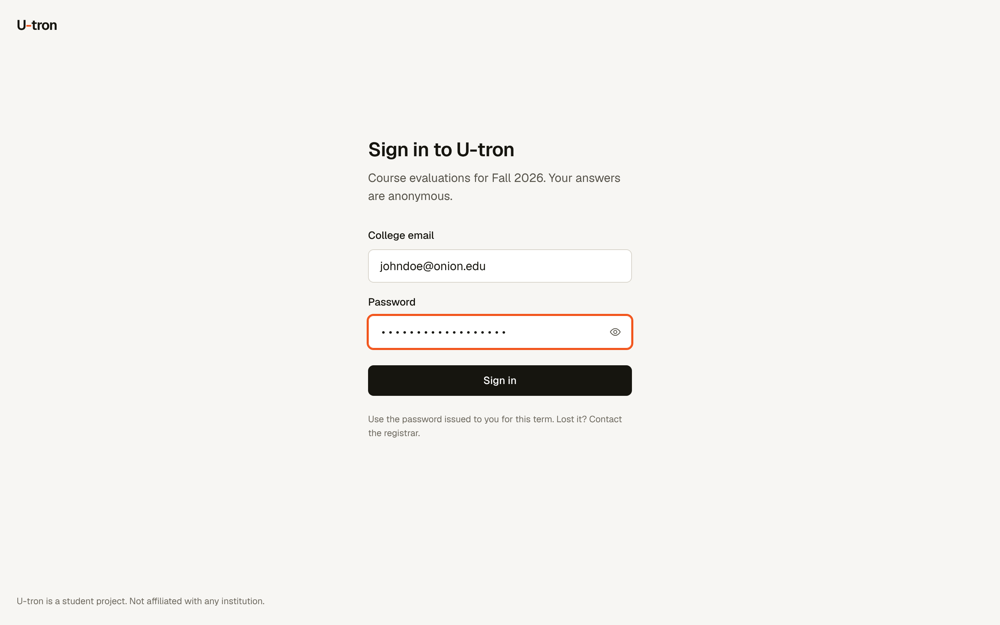
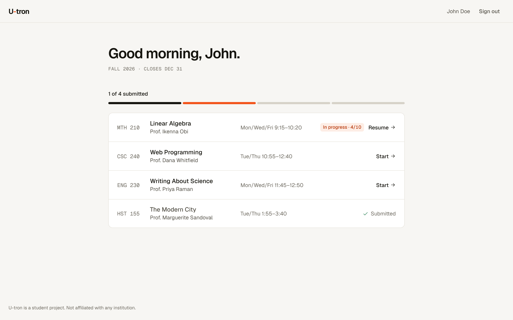
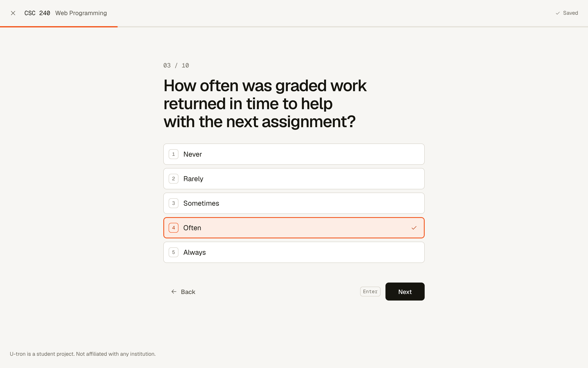
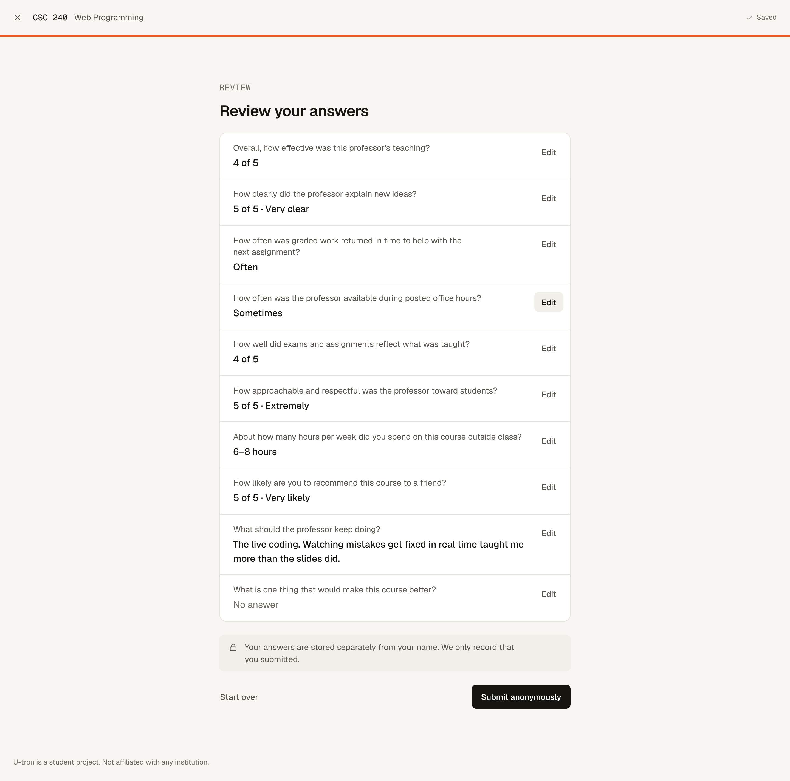
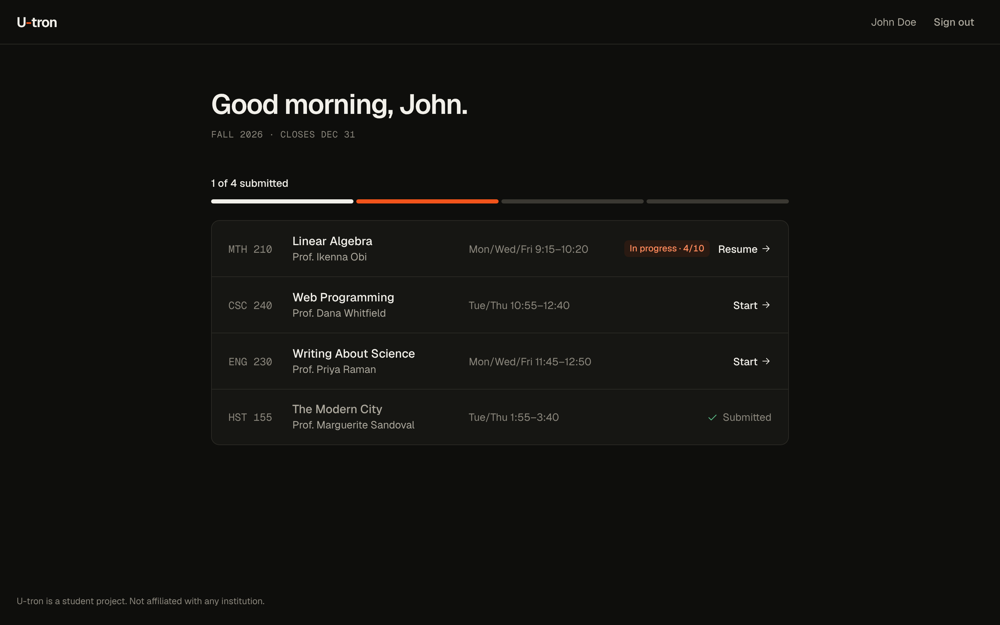
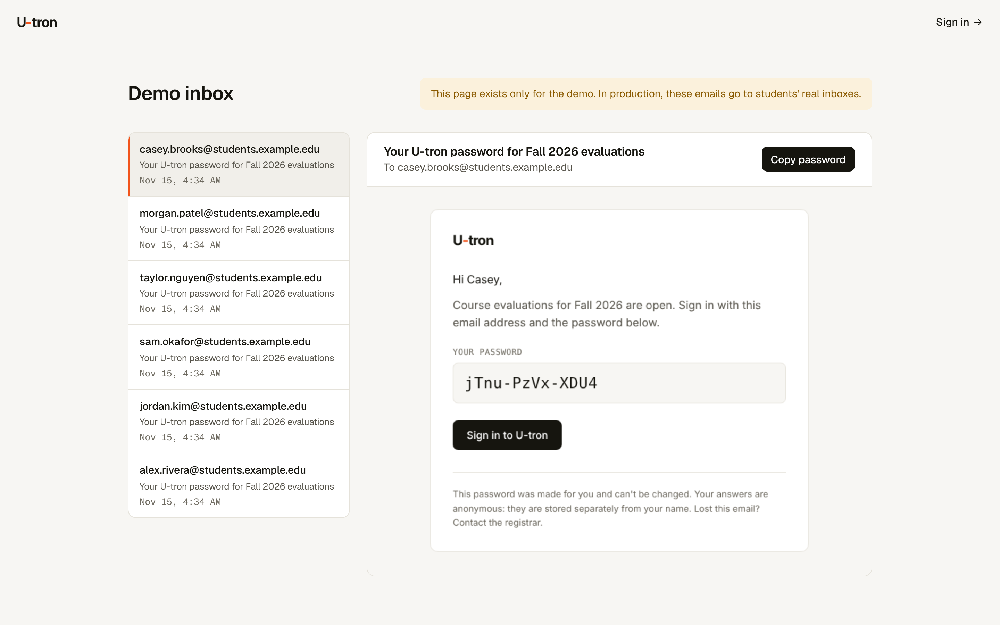
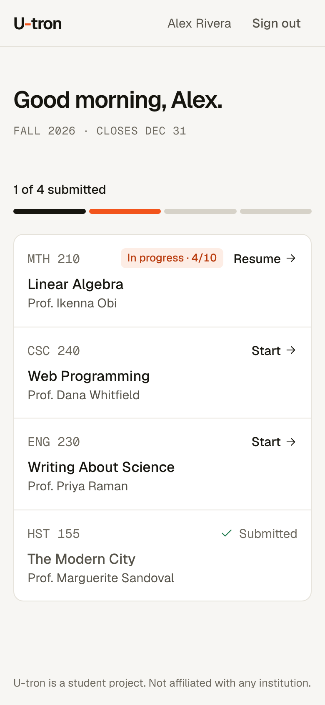
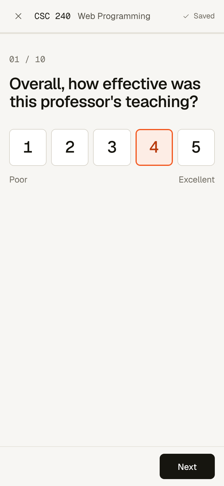
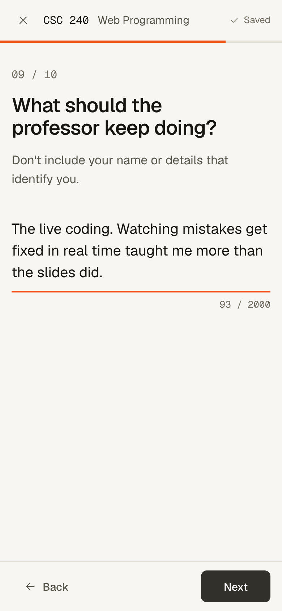
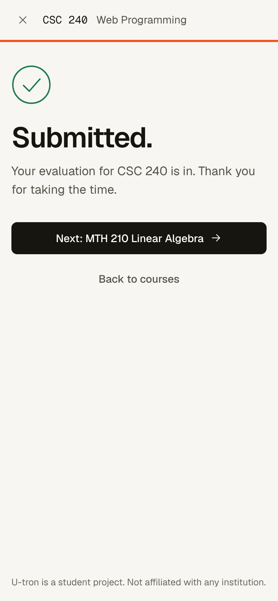

# U-tron

Course evaluations with real passwords and anonymous answers.

The college's current evaluation system lets anyone sign in with only an email
address — no password — so anyone who knows a classmate's email can submit that
classmate's evaluations. U-tron fixes that with real, hashed passwords. It then
goes one step further: answers are stored **anonymously**, in a collection that
has no link back to the student, so not even someone with full access to the
database can tell who wrote what.

Built for CSC 240 (Web Programming), Track 2: Backend & Database
(Node.js + MongoDB).

## Screenshots

| Sign in | Dashboard |
|---|---|
|  |  |

| One question per screen | Review before submitting |
|---|---|
|  |  |

| Dark theme | Demo inbox |
|---|---|
|  |  |

<p>
  
  
  
  
</p>

Every screen, on desktop and phone, is in [`docs/screenshots/`](docs/screenshots).

## Features

- **Real sign-in.** Each student gets a generated password by email. Only its
  bcrypt hash is stored. Failed sign-ins are rate-limited and never reveal
  whether an email has an account.
- **Anonymous answers.** A submission writes two unrelated documents: a receipt
  (*who* submitted) and a response (*what* was said). Nothing connects them.
- **One submission per course, guaranteed by the database.** A unique index
  rejects a second receipt even if two requests arrive at the same instant.
- **All-or-nothing submit.** Receipt, response and draft cleanup happen in one
  MongoDB transaction.
- **One question per screen**, with number-key and Enter shortcuts, a progress
  bar, and a review step before submitting.
- **Autosave and resume.** Answers are saved as you go; closing the tab,
  refreshing, or an expired session never loses them.
- **Light and dark themes**, keyboard accessible, and laid out for phones.
- **Demo inbox** that shows the password emails without sending real email.

## Tech stack

| Layer | Choice | Why |
|---|---|---|
| Runtime | Node.js 20+ | Required by Track 2. |
| Server | Express 5 | Minimal and standard. Version 5 forwards errors from `async` route handlers on its own, so routes need no try/catch boilerplate. |
| Database | MongoDB Atlas, official `mongodb` driver | Matches the Track 2 handout. The driver keeps every query explicit. Atlas supports transactions, which the submit needs. |
| Sessions | `express-session` + `connect-mongo` | Sessions live in MongoDB and survive restarts. The browser only holds a random id in an httpOnly cookie. |
| Passwords | `bcryptjs`, cost 12 | Deliberately slow hashing. Pure JavaScript, so `npm install` never needs a compiler. |
| Security | `helmet`, `express-rate-limit` | Security headers with a strict Content Security Policy; brute-force protection on sign-in. |
| Config | `dotenv` | Secrets stay in `.env`, never in code. |
| Frontend | Plain HTML, CSS and JavaScript (ES modules) | No framework and no build step: nothing to break, and every line can be explained. |
| Fonts | Geist Sans and Geist Mono, self-hosted | Keeps the CSP strict and works offline. |
| Tests | `node:test`, `supertest`, `mongodb-memory-server` | Node's built-in test runner, real HTTP requests, and a throwaway database. |

## Setup

**You need:** [Node.js](https://nodejs.org) 20 or newer, and a free
[MongoDB Atlas](https://cloud.mongodb.com) cluster.

1. Get the code and install dependencies:

   ```bash
   git clone https://github.com/Syed-OS/utron.git
   ```

   ```bash
   cd utron
   ```

   ```bash
   npm install
   ```

2. Create your settings file by copying `.env.example` to `.env`
   (`cp .env.example .env` on macOS/Linux, `copy .env.example .env` on Windows),
   then edit `.env`:

   - `MONGODB_URI` — your Atlas connection string (*Connect → Drivers*), with
     your database user's password filled in.
   - `SESSION_SECRET` — any long random string. This prints a good one:

     ```bash
     node -e "console.log(require('crypto').randomBytes(32).toString('hex'))"
     ```

   On Atlas, make sure your IP address is allowed under *Network Access*.

3. Create the demo courses and students:

   ```bash
   npm run seed
   ```

4. Start the server:

   ```bash
   npm start
   ```

5. Open <http://localhost:3000>. To get a password, open the demo inbox at
   <http://localhost:3000/inbox.html>, pick a student, and press
   **Copy password**.

### Demo accounts

`npm run seed` prints a table of every student's email and password, and puts
the same passwords in the demo inbox. Passwords are generated fresh each time
the database is seeded, so they are not listed here.

Sign in as **Alex Rivera** to see all three course states at once: one
evaluation submitted, one in progress, and two not started.

To wipe everything and start over (new passwords, clean data):

```bash
npm run seed -- --reset
```

### No Atlas, or no internet?

A throwaway local database is included as a backup:

```bash
npm run db:local
```

It prints a `MONGODB_URI` line. Put that in `.env`, leave the window open, and
run `npm run seed` and `npm start` in a second window. The data disappears when
you stop it.

## CRUD

| Operation | Where it happens | Collection |
|---|---|---|
| **Create** | Submitting an evaluation (receipt + anonymous response) | `submissions`, `responses` |
| **Read** | The dashboard lists enrolled courses with their status; the evaluation page loads the course, the questions and the draft | `courses`, `submissions`, `drafts` |
| **Update** | Autosave while answering (an upsert) | `drafts` |
| **Delete** | "Start over" discards a draft; submitting deletes it too | `drafts` |

## Project structure

```
utron/
├── server.js                  entry point: load settings, connect, listen
├── src/
│   ├── app.js                 builds the Express app (also used by the tests)
│   ├── db.js                  MongoDB client, collections, indexes
│   ├── config/
│   │   └── questions.js       the questionnaire (versioned)
│   ├── middleware/
│   │   ├── requireAuth.js     blocks requests without a session
│   │   └── errorHandler.js    404s and the final error handler
│   ├── routes/
│   │   ├── auth.js            login, logout, me
│   │   ├── courses.js         course list, evaluation, drafts, submit
│   │   └── demoInbox.js       demo-only inbox API
│   └── services/
│       ├── passwords.js       generate, hash, verify
│       ├── mailer.js          writes "emails" to outbox/
│       ├── passwordEmail.js   the password email's text and HTML
│       └── validateAnswers.js checks answers against the questionnaire
├── scripts/
│   ├── seed.js                demo courses and students
│   └── local-db.js            optional local database
├── public/                    the frontend, served as static files
│   ├── index.html             sign in
│   ├── courses.html           dashboard
│   ├── evaluate.html          questions, review, done
│   ├── inbox.html             demo inbox
│   ├── 404.html
│   ├── css/                   tokens, base, components, pages
│   ├── js/                    api, ui, login, courses, evaluate, inbox
│   └── fonts/
├── tests/                     unit tests and API tests
└── docs/                      architecture, code tour, dev log, screenshots
```

## API

All routes send and receive JSON. Everything except sign-in, `config`,
`health` and the demo inbox requires a session.

| Method | Path | What it does |
|---|---|---|
| POST | `/api/auth/login` | Sign in with `{ email, password }`. Rate-limited. |
| POST | `/api/auth/logout` | End the session. |
| GET | `/api/me` | The signed-in student's name, email and term. |
| GET | `/api/courses` | Enrolled courses, each with a status and progress. |
| GET | `/api/courses/:courseId/evaluation` | Course, questionnaire and saved draft. |
| PUT | `/api/courses/:courseId/draft` | Autosave answers (partial answers allowed). |
| DELETE | `/api/courses/:courseId/draft` | Discard the draft. |
| POST | `/api/courses/:courseId/submit` | Submit anonymously. `409` if already submitted. |
| GET | `/api/config` | Public settings for the sign-in page. |
| GET | `/api/health` | `{ ok: true }` when the server is up. |
| GET | `/api/demo/inbox` | List demo emails. Only exists when `DEMO_INBOX=true`. |
| GET | `/api/demo/inbox/:id/html` | One email's HTML, for the sandboxed preview. |

## Tests

```bash
npm test
```

29 tests using Node's built-in test runner. The API tests make real HTTP
requests against the app with an in-memory MongoDB, so they need no Atlas
connection. The first run downloads that database once (about a minute);
later runs take a few seconds.

They cover answer validation, password generation and hashing, sign-in
(including the identical response for a wrong password and an unknown email),
the session guard, enrollment checks, drafts, submitting, double submission,
two submits racing each other, and an **anonymity test** that inspects a stored
response and asserts it holds nothing that identifies the student.

## Security and anonymity

- **Passwords** are hashed with bcrypt (cost 12). The plaintext exists only in
  the email sent to the student.
- **Sessions** use an httpOnly, `SameSite=Strict` cookie holding a random id.
  The id is regenerated at sign-in and destroyed at sign-out.
- **Sign-in** returns the same error for a wrong password and an unknown
  email, takes the same time either way, and locks out after 10 failures in
  15 minutes.
- **Content Security Policy:** scripts, styles and fonts load only from this
  site. No inline scripts, styles or event handlers anywhere.
- **Input** is never trusted: request bodies are capped at 20kb, emails and
  passwords must be plain strings (which blocks MongoDB operator injection),
  course ids are pattern-checked, and every answer is re-validated on the
  server against the questionnaire.
- **Enrollment** is checked on the server for every course route.
- **Responses hold no student id, email, session id, IP address or
  timestamp.** Receipts and responses use random UUIDs instead of MongoDB
  ObjectIds (an ObjectId contains its creation time), and receipts store only
  the date.
- **Secrets** live in `.env`, which git ignores.

The full design, with diagrams and its honest limits, is in
[`docs/ARCHITECTURE.md`](docs/ARCHITECTURE.md).

## More documentation

- [`docs/ARCHITECTURE.md`](docs/ARCHITECTURE.md) — system, data and submit
  diagrams; how anonymity works.
- [`docs/CODE_TOUR.md`](docs/CODE_TOUR.md) — three key pieces of code, explained.
- [`docs/DEV_LOG.md`](docs/DEV_LOG.md) — problems hit during the build and how
  they were fixed.

## Credits

Geist Sans and Geist Mono are by Vercel, used under the SIL Open Font License
(see [`public/fonts/LICENSE.txt`](public/fonts/LICENSE.txt)).

U-tron is a student project. Not affiliated with any institution.
