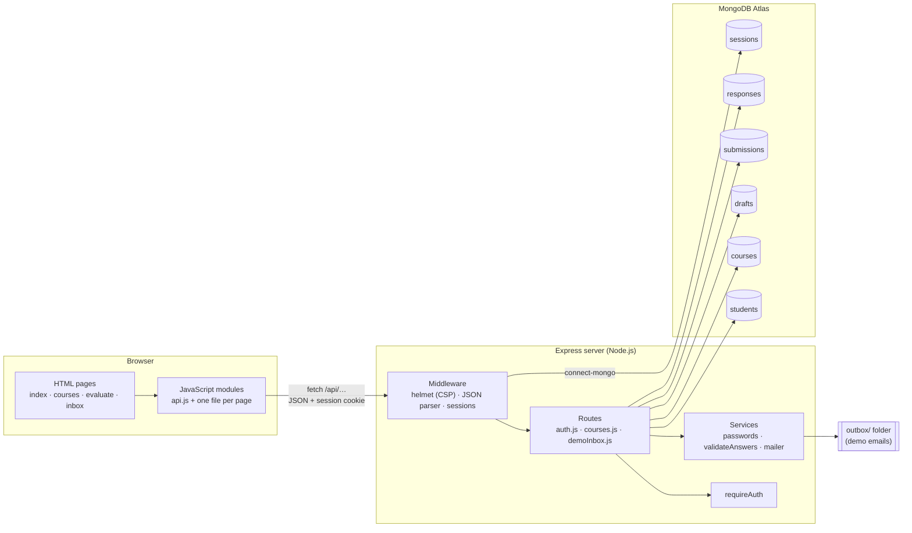
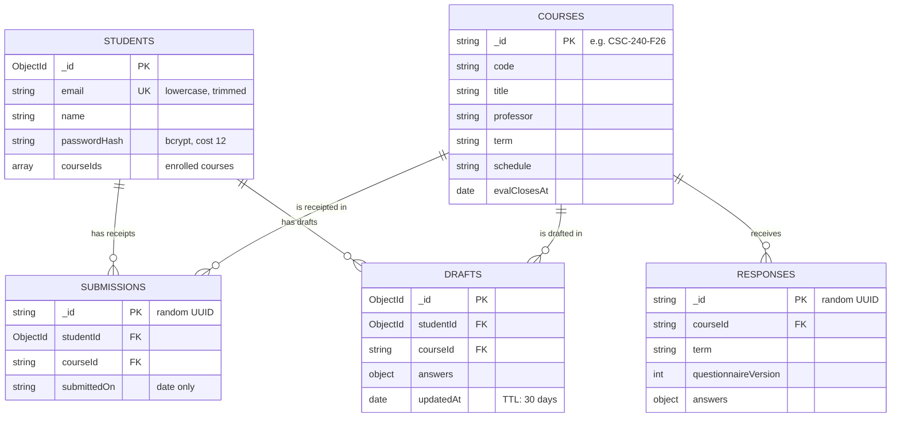
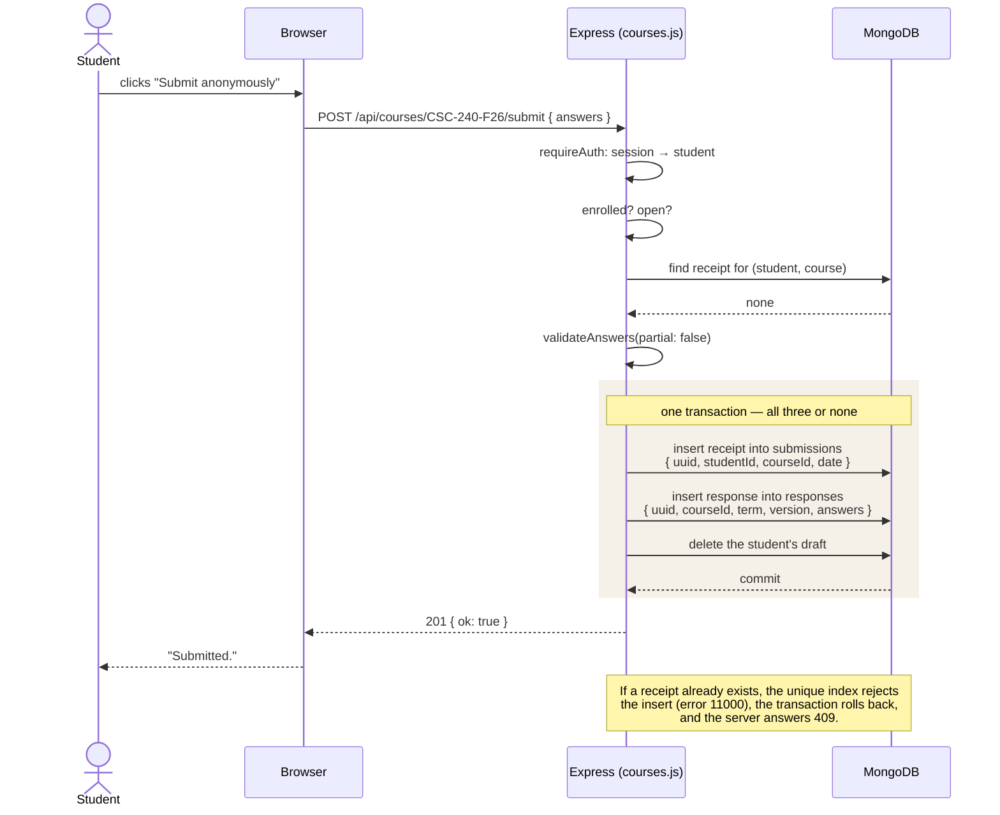

# Architecture

How U-tron is put together, how its data is shaped, and how it keeps answers
anonymous.

## The system

The browser loads plain HTML, CSS and JavaScript. That JavaScript talks to the
server only through a JSON API. The server is the only thing that talks to the
database.

A request to a protected route passes through, in order:

1. **helmet** — adds security headers, including the Content Security Policy.
2. **express.json** — parses the body and rejects anything over 20kb.
3. **express-session** — reads the `utron.sid` cookie and loads that session
   from the `sessions` collection.
4. **requireAuth** — returns 401 unless the session holds a student id, then
   loads that student.
5. **The route handler** — checks enrollment, validates input, and reads or
   writes the database.
6. **errorHandler** — catches anything thrown and replies with a generic 500.

## The data

Six collections. The important thing in this diagram is what is **missing**:
there is no line between `students` and `responses`.

(The sixth collection, `sessions`, is managed entirely by `connect-mongo`.)

**Indexes** (all created at startup in `src/db.js`):

| Collection | Index | Purpose |
|---|---|---|
| `students` | `{ email: 1 }` unique | No two accounts share an email. |
| `submissions` | `{ studentId: 1, courseId: 1 }` unique | One submission per student per course, enforced by the database. |
| `drafts` | `{ studentId: 1, courseId: 1 }` unique | One draft per student per course; autosave upserts into it. |
| `drafts` | `{ updatedAt: 1 }` TTL, 30 days | Abandoned drafts delete themselves. |

### CRUD

| Operation | Where it happens | Collection |
|---|---|---|
| **Create** | Submitting an evaluation (receipt + anonymous response) | `submissions`, `responses` |
| **Read** | The dashboard lists enrolled courses with their status; the evaluation page loads the course, the questions and the draft | `courses`, `submissions`, `drafts` |
| **Update** | Autosave while answering (an upsert) | `drafts` |
| **Delete** | "Start over" discards a draft; submitting deletes it too | `drafts` |

## The submit

Submitting is the one place where several writes must succeed or fail
together, so it runs inside a MongoDB transaction.

Why a transaction, and not three separate writes? Consider a crash between
them:

- Response written, receipt not → the student could submit **again**.
- Receipt written, response not → the evaluation is **lost**, and the student
  is locked out of redoing it.

With a transaction neither can happen.

## How anonymity works

The goal: **someone with full read access to the database cannot tell which
student wrote which response.** Five decisions work together to get there.

**1. Two collections that do not reference each other.**
`submissions` records *who* submitted for *which course*. `responses` records
*what was said* for *which course*. A response has no student id, no email, no
session id, no IP address. There is no field to join on.

**2. Random UUIDs instead of ObjectIds.**
MongoDB's default `_id` is an ObjectId, and the first four bytes of an
ObjectId are the time it was created, to the second. A receipt and a response
created by the same request would have ObjectIds a few milliseconds apart —
which is as good as a link. Both collections use `crypto.randomUUID()`
instead; a random UUID contains no time.

**3. Receipts store the date, not the time.**
For the same reason, `submittedOn` is `"2026-11-15"`, not a full timestamp.
Responses store no time at all.

**4. The draft is deleted in the same transaction.**
While a student is answering, their draft *is* linked to them — it has to be,
so they can leave and resume. That is a deliberate trade-off. The link is cut
at the moment of submission: the draft is deleted in the same transaction that
writes the anonymous response, so there is never a moment where both a
finished response and a named draft of it exist.

**5. Request bodies are never logged.**
No route logs what was submitted, and the error handler logs only the error's
stack trace. Answers cannot end up in a log file next to a session or a name.

The automated test `ANONYMITY: a stored response cannot be traced to the
student` (in `tests/api.test.js`) checks points 1–3 against a real stored
document.

### Honest limits

Separating the data removes the *direct* link. It does not make
re-identification impossible in every situation, and it is better to say so:

- **Small classes.** In a course with three students, the answers themselves
  can hint at who wrote them. Real systems hold results back until a minimum
  number of responses is in. U-tron has no results view yet, so this is where
  such a threshold would go.
- **Free text.** A student can identify themselves in a written answer. The
  form asks them not to, but cannot stop them.
- **Insertion order.** MongoDB tends to return documents in the order they
  were inserted. Someone comparing the order of `submissions` with the order
  of `responses` could make educated guesses, especially when few students
  submit. Shuffling or batching writes would address this.
- **Infrastructure outside the app.** The database keeps an internal operation
  log (used for replication) that briefly records write times, and a hosting
  provider keeps network logs. The app does not create these and cannot remove
  them. A production deployment would need a policy for them.
- **Timing by observation.** If only one student submits on a given day, the
  receipt's date and the appearance of one new response line up. Date-only
  receipts blur this; they do not erase it.

None of these is an accident of the code — they are the edges of what
application-level separation can promise.

## Security, in one table

| Threat | Defence | Where |
|---|---|---|
| Stolen database reveals passwords | bcrypt hashes, cost 12, salted | `services/passwords.js` |
| Guessing passwords | 10 failed attempts per 15 minutes per IP | `routes/auth.js` |
| Discovering which emails have accounts | One error message; one bcrypt comparison either way | `routes/auth.js` |
| Session fixation | Session id regenerated at sign-in | `routes/auth.js` |
| Cookie theft by script | `httpOnly` cookie | `app.js` |
| Cross-site request forgery | `SameSite=Strict` cookie | `app.js` |
| Cross-site scripting | Strict CSP; all dynamic text escaped | `app.js`, `public/js/ui.js` |
| MongoDB operator injection | Email and password must be strings; ids pattern-checked; answers validated field by field | `routes/auth.js`, `routes/courses.js`, `services/validateAnswers.js` |
| Reading another student's course | Enrollment checked on the server on every request | `routes/courses.js` |
| Submitting twice | Unique index + transaction | `db.js`, `routes/courses.js` |
| Oversized requests | 20kb body limit | `app.js` |
| Leaking internals | Generic 500 message; details logged server-side only | `middleware/errorHandler.js` |
| Open redirect after sign-in | `next` must be a same-site path | `public/js/login.js` |
| Leaked secrets | `.env` is git-ignored | `.gitignore` |
